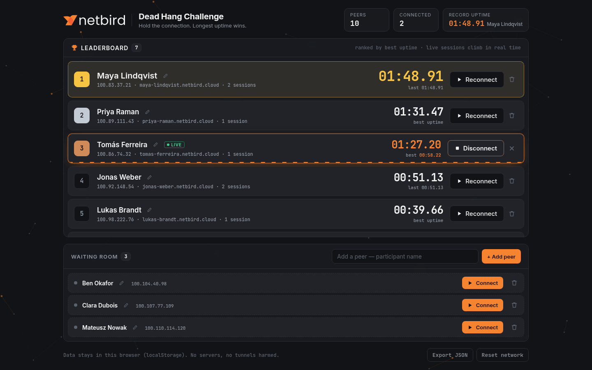
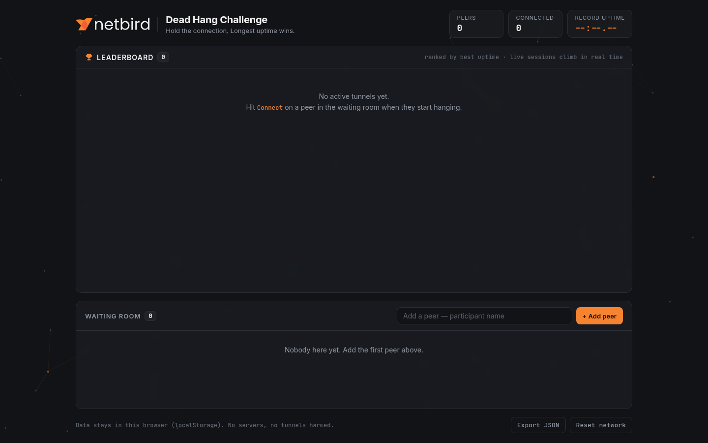
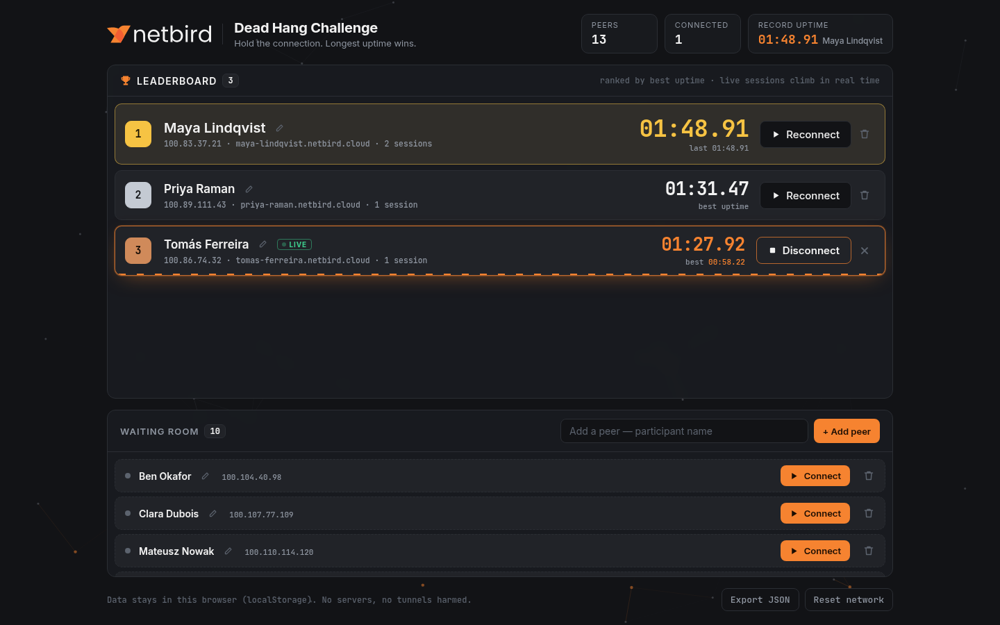
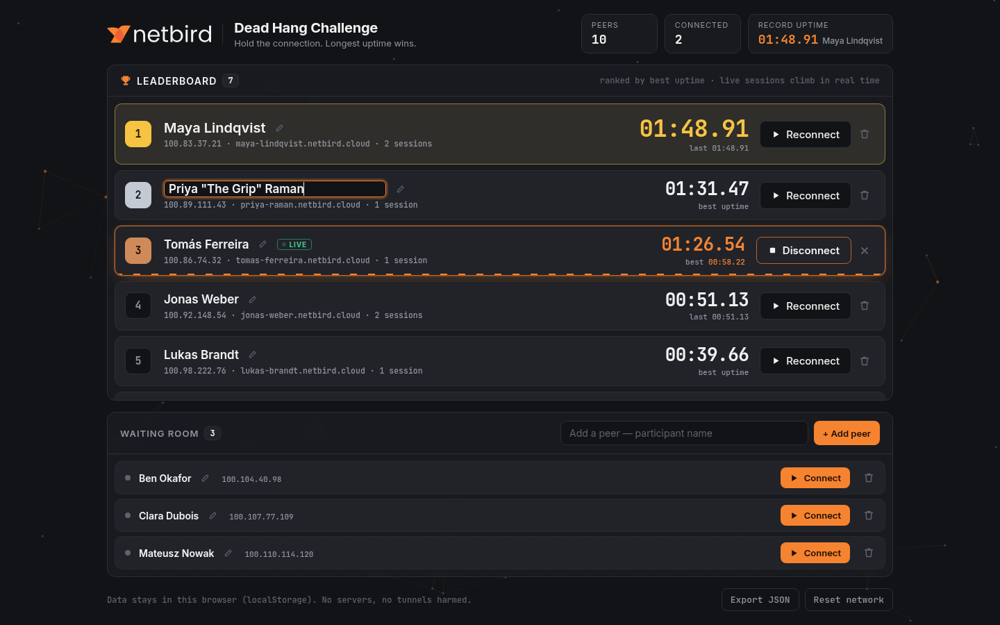

# Dead Hang Uptime

**A NetBird-themed timer and live leaderboard for the hackathon's dead hang side challenge.**
Every participant is a *peer* on the network. Grabbing the bar *connects* them. The person who keeps the longest *uptime* wins.



> One HTML file. No build, no backend, no install. Open `index.html` in a browser.

---

## The challenge

A **dead hang** means hanging from a pull-up bar with straight arms for as long as you can. It runs as a side challenge during the [NetBird](https://netbird.io) hackathon: people come over between coding sessions, hang, and try to top the board.

The organisers needed a way to:

1. register participants quickly,
2. time each attempt accurately, often with several people hanging at once,
3. show a leaderboard on a screen that everyone can see from across the room.

A spreadsheet and a phone stopwatch can't keep up with that. This app handles all three on one screen.

## What it does

| | |
|---|---|
| **Waiting room** | New participants are added here. They wait with a **Connect** button until it's their turn. |
| **Connect / Disconnect** | Starts and stops that person's timer. Any number of people can be timed at the same time. |
| **Live leaderboard** | Takes up two thirds of the screen. A person joins it the moment their timer starts, and the list re-sorts five times a second, so a live attempt visibly climbs past other people. |
| **Personal bests** | Each person is ranked by their best attempt. **Reconnect** starts another try, and the timer turns orange once the current attempt beats their previous best. |
| **False starts** | **✕** discards a running attempt. If it was the person's first try, they go back to the waiting room. |
| **Rename** | Double-click a name, or use the ✏️ icon. Works while a timer is running. |
| **Header stats** | Total peers, how many are hanging right now, and the record time with who holds it. |
| **Export / Reset** | Download all results as JSON, or clear everything after a confirmation prompt. |

## The NetBird theme

The idea was to make the app look like a NetBird network, not a generic stopwatch with a logo on it. Every concept maps to something in NetBird:

| Dead hang | In the app (NetBird / VPN language) |
|---|---|
| Participant | **Peer**, with an address in `100.64.0.0/10` (the CGNAT range NetBird assigns peers from) and a `name.netbird.cloud` hostname |
| Grabbing the bar | **Connect**: the status dot pings green and a **LIVE** badge appears |
| Hanging | An animated **packet stream** runs along the bottom of the row |
| Dropping off the bar | **Disconnect** |
| Time on the bar | **Uptime** |
| Not started yet | **Waiting room** |
| Clearing all data | **Reset network** |
| Background | A slowly drifting **mesh of peers and links**, some lit in NetBird orange |

**Brand:** the official NetBird logo SVG and the brand colours `#F68330` / `#F35E32` / `#F2F2F2` are taken directly from netbird.io's logo file. The rest of the palette is a dark theme designed to match: dark greys, green for "online", gold, silver and bronze for the podium. It uses Inter for text and JetBrains Mono for times, addresses and other numbers.

## Screenshots

**Empty network:** first launch, before anyone joins.



**Busy waiting room:** the waiting room grows until it fills a third of the screen, then scrolls on its own. The leaderboard always keeps the other two thirds.



**Inline rename:** the edit happens in place. Enter saves and Esc cancels. Empty names and duplicate names are rejected.



## Running it

```sh
# any of these
xdg-open index.html            # Linux
open index.html                # macOS
python3 -m http.server 8000    # then visit http://localhost:8000
```

It also works when hosted as a static file anywhere, such as GitHub Pages or a USB stick plugged into the screen at the bar.

**Suggested setup at the event:** run it full-screen on a monitor or TV next to the bar, with a laptop or phone acting as the timekeeper.

## How it's built

- **One file, no dependencies.** HTML, CSS and plain JavaScript in `index.html`, about 750 lines. The only external request is Google Fonts, and it falls back to system fonts when offline.
- **Fully in the browser.** All state lives in `localStorage` under the key `netbird-deadhang-v1`. No server, accounts or tracking.
- **Timers survive a reload.** The app saves *when* an attempt started, not a running counter. If the tab is closed or the laptop sleeps mid-attempt, the time is still correct after reopening.
- **Several tabs stay in sync.** A `storage` event listener keeps open tabs consistent. For example, the timekeeper can use one window while the big screen shows another on the same machine.
- **Smooth live re-ranking.** Timers update every animation frame. When the ranking changes, the app moves the existing rows instead of redrawing them, and slides them to their new places with the [FLIP](https://aerotwist.com/blog/flip-your-animations/) technique. Because of this, a **Disconnect** click is never lost to a redraw mid-click, which matters when someone's arms are giving out.
- **Responsive and accessible.** On desktop everything fits one screen, and on phones it becomes a single column. All animations are disabled under `prefers-reduced-motion`. Names are HTML-escaped before display.

### Data model

```jsonc
{
  "peers": [
    {
      "id": "k2x9…",
      "name": "Maya Lindqvist",
      "ip": "100.83.37.21",
      "attempts": [{ "ms": 108910, "at": 1762512345678 }],  // finished attempts
      "runningSince": null                                   // epoch ms while hanging
    }
  ]
}
```

A peer is shown in the **waiting room** while `attempts` is empty and `runningSince` is `null`. Otherwise they're on the **leaderboard**, ranked by `max(best attempt, current live time)`.

## Project layout

```
index.html                    the whole app
docs/screenshots/             README images
scripts/make_screenshots.py   regenerates the screenshots with headless Chrome
```

The screenshots use made-up demo data, which the script loads into a temporary copy of the app. To regenerate them:

```sh
python3 scripts/make_screenshots.py
```

## Known limitations

- Data is stored per browser. Clearing site data or switching to another machine starts from an empty network, so use **Export JSON** to keep results.
- Timing uses the device clock (`Date.now()`), accurate to about one hundredth of a second, which is enough for a dead hang. Changing the system clock in the middle of an attempt would change that attempt's time.
- On very narrow phones (about 390px wide), the record box in the header overflows and long names are cut short. Desktop and tablet layouts are not affected.

## Credits

Built during the NetBird hackathon. The NetBird name and logo belong to [NetBird](https://netbird.io) and are used here only to theme an internal event tool.
